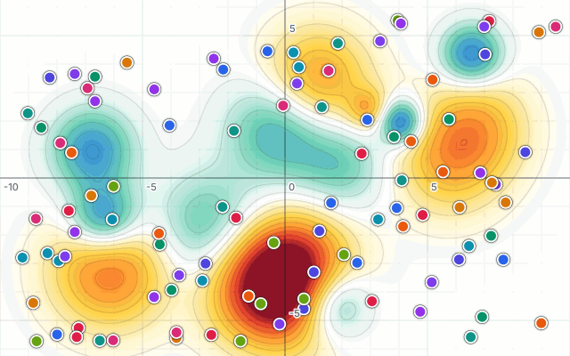
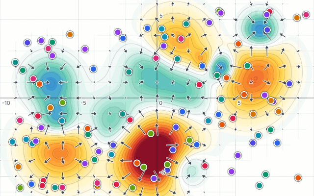

# Langevin Dynamics

An interactive, real-time simulator of the overdamped Langevin equation

```math
dX_t = -\nabla\Psi(X_t)\,dt + \sigma\,dW_t ,\qquad X_t\in\mathbb{R}^2
```

on a potential landscape $\Psi$ that you paint with the mouse. Hills (warm colours, $\Psi>0$) push
particles away, valleys (cool colours, $\Psi<0$) attract them, and Brownian noise with diffusivity
$\sigma$ shakes them around. Everything can be changed while the simulation is running.

It is a static site with no backend, so it runs on GitHub Pages.
**Try it live: <https://erencan-02.github.io/overdamped-langevin/>**

<table>
  <tr>
    <td width="50%"></td>
    <td width="50%"></td>
  </tr>
  <tr>
    <td align="center"><sub>Random landscape, 100 particles, σ = 0.6</sub></td>
    <td align="center"><sub>Same run with the force field −∇Ψ switched on</sub></td>
  </tr>
</table>

## Using it

| Action | How |
| --- | --- |
| Switch tool | **Brush** / **Particles** in the toolbar (or <kbd>B</kbd> / <kbd>P</kbd>) |
| Raise Ψ | Brush mode, hold the **left** mouse button |
| Lower Ψ | Brush mode, hold the **right** mouse button |
| Drop a particle | Particle mode, **click** |
| Spray particles | Particle mode, **Shift + drag** |
| Spawn a grid of particles | Particle mode, **right-drag** a rectangle; spacing is set by *Grid spacing* in the panel |
| Remove a particle | Particle mode, **right-click** it |
| Undo / redo | <kbd>Ctrl</kbd>+<kbd>Z</kbd> / <kbd>Ctrl</kbd>+<kbd>Shift</kbd>+<kbd>Z</kbd> (or <kbd>Ctrl</kbd>+<kbd>Y</kbd>): brush strokes and other changes of Ψ, added and removed particles |
| Pan | Hold the **mouse wheel** and drag (or **Alt + drag**) |
| Zoom | **Scroll** |
| Play / pause | **Play** button or <kbd>Space</kbd> |
| Potential formula | *Potential Ψ* window (top left): switch on *Use a formula* and type Ψ(t, x, y) in LaTeX (x, y, r, \theta, t, \sigma), or click an example. The gradient is derived symbolically, so the dynamics have no lattice and no cap; Ψ may depend on time. The heat map and the 3D relief evaluate the formula on the GPU (compiled to GLSL and checked against the exact values first) |
| Births and deaths | *Birth / death* window: switch on and set the rates λ and μ. Every particle has its own exponential birth and death clocks; a birth adds a particle at the parent's position, a death removes it. The plot compares N(t) with N₀e^{(λ−μ)t}, and recordings store every event (`birth_t`, `birth_parent`, `birth_child`, `death_t`, `death_id`) |
| Single step | <kbd>→</kbd> takes one step of Δt = 2 ms (or shows the next frame of a recording); **hold** <kbd>→</kbd> to play while it is held |
| 3D view | **2D / 3D** switch next to Brush / Particles (or <kbd>2</kbd> / <kbd>3</kbd>): Ψ as a relief with the particles on it, computed on the GPU. The brush and the particle tools (click, Shift-drag spray, right-click remove) work on the surface; **middle-drag** or **Alt + drag** orbits, **Shift + middle-drag** pans, **scroll** zooms, one finger orbits on touch screens. The live camera works in 3D too; images and recordings are opened in 2D |
| Grid / trails / contours | Toolbar toggles or <kbd>G</kbd> / <kbd>T</kbd> / <kbd>L</kbd> |
| Force field −∇Ψ (arrows) | Toolbar toggle or <kbd>F</kbd> |
| Image → Ψ | **Drop an image on the left half** of the window, or Scene menu → *Image → Ψ…* (<kbd>I</kbd>) |
| Image → particles | **Drop an image on the right half**, or Scene menu → *Image → particles…* (<kbd>Shift</kbd>+<kbd>I</kbd>) |
| Live camera → Ψ | Camera button in the toolbar (<kbd>V</kbd>); click again to stop and keep the last frame |
| Numerical scheme | Heun / Euler–Maruyama / Milstein in the panel, or <kbd>S</kbd> to cycle |
| Drift & noise | **Drift & noise** window: add a drift $u(t,x,y)$ (e.g. a rotation) and/or state-dependent noise $s_1, s_2$ typed in LaTeX |
| Seed | *Seed* field in the panel (default 0): same seed + same actions = identical run |
| Replay a recording | **Drop an `.npz`** recording anywhere, or Scene menu → *Open recording* (<kbd>O</kbd>) |
| Presets, clear, reset view | Scene menu (layers icon), <kbd>C</kbd> clear particles, <kbd>X</kbd> clear Ψ, <kbd>R</kbd> reset view |

The panel at the bottom left sets the diffusivity σ, the simulation speed, the numerical scheme and the brush size
(standard deviation of the Gaussian brush) and strength (rate of change of Ψ at the brush centre).
$|\Psi|$ is capped at 5.

## How it works

**Potential.** Ψ lives on a regular lattice (spacing $h = 0.04$) split into lazily allocated
128 × 128 chunks, so the plane is effectively unbounded and memory only grows with the painted area.
The brush adds a Gaussian bump $A\thinspace e^{-r^2/2s^2}$ and clamps the result to $[-5, 5]$. The nodal
gradient is kept up to date with second-order central differences and bilinearly interpolated,
which gives a continuous drift field with $O(h^2)$ error.

**Images as potentials.** A dropped image is decoded in a Web Worker (`createImageBitmap` +
`OffscreenCanvas`, with an `` fallback, e.g. for SVG), resampled to the potential grid with
step-wise downscaling, and converted to perceptual lightness (CIE L\*). After a robust contrast
stretch (1st–99th percentile), dark pixels become valleys down to $-5$, light pixels stay flat and
transparent pixels are ignored, so the Gibbs density $\propto e^{-2\Psi/\sigma^2}$ concentrates on
the dark parts of the picture. A Gaussian blur of about three grid cells keeps forces and
curvatures within what the time step can handle. *Invert* swaps light and dark. Everything runs
in the browser: nothing is uploaded.

**Live camera.** The camera button streams the front camera into Ψ through the same pipeline as
dropped images (`image/pixels.ts` → `imageToPotential` → `writePotential`). Frames are handled in
`requestVideoFrameCallback`, i.e. as soon as the browser has a new frame, directly on the main
thread (a worker round trip would add a frame of latency). Each frame is read back at about
160 × 120 samples, mirrored, and written into a fixed region of at most 16 world units, so the
per-frame cost stays at a few milliseconds. The contrast levels are smoothed over frames and never
stretched below a minimum span, so automatic exposure does not make the landscape flicker and
sensor noise in dark scenes does not turn into deep valleys. Stopping the camera keeps the last
frame. Video never leaves the browser.

**Images as particles.** Dropped on the right half of the window, an image replaces the particles
instead: 2000 particles are placed so that their density follows the same contrast-stretched
darkness that would otherwise become Ψ. The expected count per pixel is quantised with serpentine
Floyd–Steinberg error diffusion, as in halftone printing, so every region receives its share to
within one particle and the particles are spread evenly instead of clumping like independent
random samples. Ψ stays as it is, so pressing play shows how that picture diffuses and relaxes.

**Distance to equilibrium.** The window above the settings plots, over simulated time,
$\mathrm{KL}(\hat\rho_h \,\|\, \pi)$ between the particles' empirical measure smoothed with a Gaussian kernel,
$\hat\rho_h = \tfrac1N \sum_i \delta_{X_i} * \mathcal N(0, h^2 I)$ (the kernel variance $h^2$ is adjustable), and the
Gibbs measure $\pi \propto e^{-2\Psi/\sigma^2}$. Because $\pi$ is not normalisable on the whole plane (Ψ = 0 wherever
nothing is painted), both are restricted to the dashed analysis box and renormalised there; *Fit box to view*
moves the box. The estimate is a binned KDE: cloud-in-cell deposit of the particles on a grid of 64–256 cells
(≈ 1.5 cells per kernel std), a separable Gaussian blur, and a midpoint sum for the integral, recomputed ten
times per second while the window is open; π is only recomputed when Ψ, σ or the box change. The dashed line
is $\mathrm{KL}(\pi * K_h \,\|\, \pi)$, the value that perfect sampling approaches as $N \to \infty$, so
the curve should level off at or slightly above it (the excess is the finite-N noise).

**Custom observables.** The *Observable* window above it takes a test function $f(x, y)$ typed in
LaTeX (`x^2 + y^2`, `\mathbf{1}_{x>0}`, `\cos(\pi x)`, `\frac{1}{2}\sigma^2 + \Psi`, …) and plots the mean
of $f$ over the particles in the analysis box with a 95 % confidence band ($\bar f \pm 1.96\, s/\sqrt n$)
against the exact Gibbs expectation $\int_B f\,d\pi$ (a midpoint sum over ≥ 256 cells per side, recomputed
only when f, Ψ, σ or the box change). This is the weak-convergence counterpart of the KL plot, and the
remaining gap at equilibrium is the time-discretisation bias that the weak order of a scheme describes.
The input is parsed and compiled by the [Cortex Compute Engine](https://cortexjs.io/compute-engine/),
which runs in the browser and is loaded only when the window is first opened (`src/analysis/latex.ts`
adapts it: allowed symbols x, y, r, θ, σ, Ψ, indicators, and messages such as *output must be a scalar*,
shown under the input while the last valid function stays in use). Its batch evaluator computes f at all
particles and grid cells at once.

**Smoothed empirical measure.** *Show ρ̂ₕ* in the KL window (<kbd>D</kbd>) draws the kernel density
estimate on the scene as a light hot-pink fill with bold pink iso-density lines at 20–80 % of its
maximum, a hue that appears nowhere in the colour map of Ψ. It uses the same grid as the KL estimate and is
updated 30 times per second while shown.

**Reproducibility.** All randomness (Brownian noise, particle colours, spraying, image sampling,
presets) comes from named xoshiro128\*\* streams derived from one seed, and the integrator runs on a
fixed clock: every step is exactly Δt = 2 ms and leftover time is carried over to the next frame. A
run is therefore a function of the seed and the user's actions only, not of the frame rate.

**Playback.** Dropping a recording restores everything it contains and switches to playback mode:
a player at the bottom plays the run at its recorded speed and scrubs through it, while the
simulation clock and the recorder are disabled. Changing Ψ, particles or a physics setting (σ,
speed, scheme, seed) leaves playback and continues from the shown frame; since recordings store the
random state and clock remainder of every frame, continuing reproduces the original run exactly.
Viewing controls (grid, trails, density, kernel variance, camera) do not leave playback.

Saving and loading go through `src/session/`: every persistent piece of state is a
`StateComponent` (scalar settings are schema-driven `SettingsGroup`s with validated `Field`s), and a
`Session` captures, applies and fingerprints them in a fixed order. A new feature becomes
recordable and replayable by registering one more component.

**Recording runs.** The record button (<kbd>Shift</kbd>+<kbd>R</kbd>) starts and stops a recording; finished
runs appear in the *Recordings* panel on the right and download as `.npz` files:

```python
import json
import numpy as np

run = np.load("langevin-dynamics-run-1.npz")
meta = json.loads(str(run["metadata"]))          # constants, start parameters, array docs
off = run["frame_offsets"]                       # frame k: rows off[k]:off[k+1]
k = 10
ids, x, y = (run[a][off[k]:off[k + 1]] for a in ("particle_id", "x", "y"))
psi = run["psi"]                                 # (snapshots, ny, nx) on psi_grid = [x0, y0, spacing]
kl_t, kl, floor = run["kl_t"], run["kl"], run["kl_floor"]
obs_t, mean, ci, exact = run["obs_t"], run["obs_mean"], run["obs_ci"], run["obs_exact"]
f = meta["observable_expressions"]              # LaTeX of f; obs_expr indexes this list
```

A run (format 2) also stores per frame the seed, the dynamics random state (`rng_state`), the clock
remainder and the next particle id, and the full settings in the metadata. It contains particle
positions (float64) with stable ids (frames at up to 20 Hz, whenever something
changed), the simulated and wall-clock time of every frame, σ, speed, kernel variance, scheme and
play state per frame, snapshots of Ψ on the lattice over the KL box (up to 5 Hz, whenever Ψ
changed), the KL time series with its floor, h, particle count and box, and the observable
time series (mean, CI half width, exact value, particle count and the LaTeX of f). Recording stops by
itself at 400 MB of raw data; runs live in the browser tab until downloaded or deleted.

**The process.** The schemes see the SDE only through a small interface (`Process` in
`src/sim/process.ts`): a batched drift $b(t,x)$, diagonal diffusion coefficients $s_1, s_2$ (and
$\partial_x s_1$, $\partial_y s_2$ for Milstein), and *capability flags*. The app's process is

```math
dX_t = \big(-\nabla\Psi + u\big)(t, X_t)\,dt + \operatorname{diag}(s_1, s_2)(t, X_t)\,dW_t \qquad\text{(Itô)},
```

with $u = 0$ and $s_1 = s_2 = \sigma$ unless the **Drift & noise** window sets them (formulas in $t, x, y, \sigma$,
differentiated symbolically). The flags say what is known: only for the Langevin case ($u = 0$, $s = \sigma$)
is the Gibbs measure $e^{-2\Psi/\sigma^2}$ invariant, so *KL to equilibrium* and the exact $\int f\,d\pi$ switch
off otherwise; they also tell whether the noise is additive or diagonal (where Milstein has strong order 1).

**Numerical schemes.** Three interchangeable schemes are implemented in `src/sim/schemes.ts`.
Switch between them in the panel or with <kbd>S</kbd>, even while the simulation is running:

| | Update | Drift evaluations / step |
| --- | --- | --- |
| **Euler–Maruyama** | $X_{n+1} = X_n + b(X_n)\thinspace \Delta t + s(X_n)\thinspace \Delta W$ | 1 |
| **Stochastic Heun** (default) | $\tilde X = X_n + b(X_n)\thinspace \Delta t + s(X_n)\thinspace \Delta W$, then $X_{n+1} = X_n + \tfrac12\big[b(X_n) + b(\tilde X)\big]\Delta t + s(X_n)\thinspace \Delta W$ | 2 |
| **Milstein** | $X^k_{n+1} = X^k_n + b^k\thinspace \Delta t + s_k\thinspace \Delta W^k + \tfrac12 s_k\thinspace\partial_k s_k\big((\Delta W^k)^2 - \Delta t\big)$ | 1 |

with $\Delta W \sim \mathcal N(0, \Delta t\thinspace  I)$, the same increment in both Heun stages. Heun evaluates the
noise at the start of the step only, so it converges to the Itô solution also for multiplicative noise.
For multiplicative noise Euler–Maruyama and Heun have strong order ½ and Milstein strong order 1 (for
diagonal noise). When the noise is additive (σ is constant), Milstein is Euler–Maruyama and
**all schemes have strong order 1**. The difference is in the drift:
Euler–Maruyama is first order there, while Heun is second order (and is reported to have weak
order 2 for additive noise). Heun is therefore much more accurate where the force dominates the
noise, at twice the cost per step. Sub-steps are at most 2 ms of simulated time. If thousands of
particles would overrun the frame, the step grows up to a hard limit of 10 ms, and past that the
simulation slows down rather than losing accuracy. The work budget is counted in force evaluations
and adapts to the measured speed of the device, so Euler–Maruyama automatically gets twice as many
sub-steps. Gaussian increments come from a ziggurat sampler on a seedable xoshiro128** generator.

**Rendering.** WebGL2 throughout: one half-float texture per chunk (with a shared border row/column
for seamless bilinear filtering) coloured by a diverging colormap with optional iso-contours, a
procedural adaptive grid, a force-field overlay (instanced arrows drawn as signed-distance shapes on a
power-of-two lattice fixed in world space, rebuilt only when the view or Ψ changes), instanced particle sprites, and trails whose ring-buffer history is kept on
the GPU. Only the newly recorded column is uploaded each frame.

**Tests.** `npm test` checks the field discretisation against analytic Gaussians, the normal
sampler's moments and tails, free Brownian motion ($\mathrm{Var}\thinspace X_t=\sigma^2 t$), the exact
deterministic gradient flow, and relaxation to the Gibbs distribution of an Ornstein–Uhlenbeck
process ($\mathrm{Var}=\sigma^2/2k$). For the schemes, it measures the convergence order in the
drift (halving Δt divides the error by 2 for Euler–Maruyama and by 4 for Heun) and checks that each
scheme reproduces its own exact discrete stationary variance for the OU process. For multiplicative
noise it measures the strong orders on geometric Brownian motion against the exact solution
(Milstein 1, Euler–Maruyama ½) and checks that Heun converges to the Itô, not the Stratonovich, solution.

## Development

```bash
npm install
npm run dev      # local dev server
npm test         # unit and statistical tests
npm run build    # static build in dist/
```

Pushing to `main` builds, tests and deploys the site to GitHub Pages through
`.github/workflows/deploy.yml`.

## Project layout

```
src/
  sim/field.ts        chunked potential grid, brush, gradient
  sim/particles.ts    particle ensemble: state, sub-stepping, trails
  sim/process.ts      the Process interface (drift, diffusion, capabilities) and the app's SDE
  sim/schemes.ts      numerical schemes (Euler–Maruyama, stochastic Heun, Milstein)
  sim/rng.ts          xoshiro128** + ziggurat normal sampler
  sim/presets.ts      ready-made landscapes
  render/             WebGL2 renderer and shaders
  view/               camera, grid spacing, 2D overlay (labels, cursor)
  ui/                 pointer input and DOM controls
  main.ts             wiring and the frame loop
tests/                vitest suites
```
